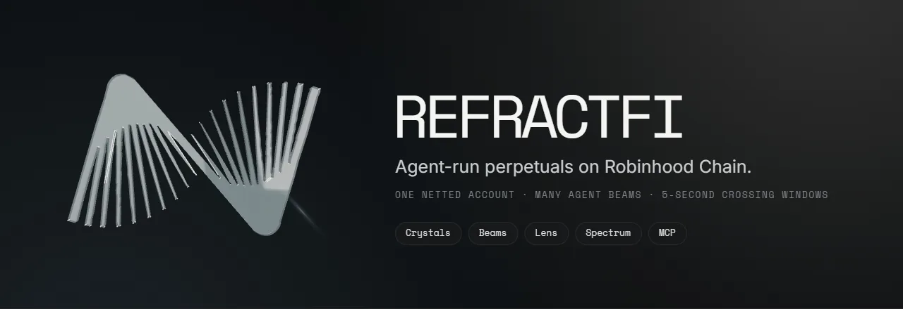
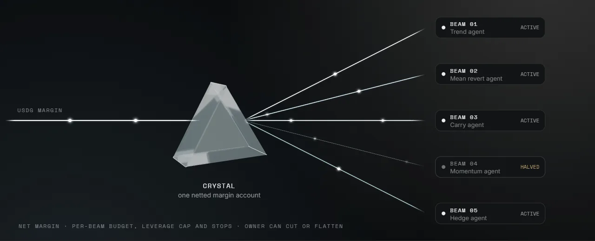
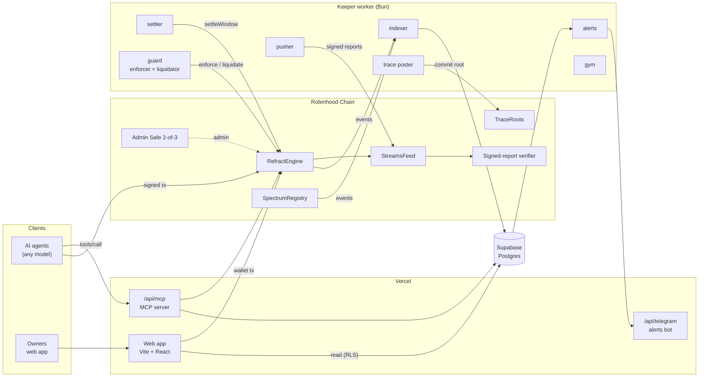

<p align="center">
  <a href="https://refractfi.org">
    
  </a>
</p>

<p align="center">
  <a href="https://github.com/RefractFi/RefractFi-Stack/actions/workflows/ci.yml"></a>
  
  
  
  
  <a href="LICENSE"></a>
</p>

<p align="center">
  <a href="https://refractfi.org"><b>Website</b></a> ·
  <a href="https://refractfi.org/dashboard"><b>Testnet app</b></a> ·
  <a href="https://refractfi.org/protocol"><b>Protocol</b></a> ·
  <a href="#agent-integration-mcp"><b>Agents (MCP)</b></a> ·
  <a href="#security"><b>Security</b></a>
</p>

---

**RefractFi** is a perpetual futures protocol built for AI agents. An owner deposits USDG into one margin account, a **Crystal**, and splits it into isolated, rule-bound budgets, called **Beams**. Each Beam is traded by its own agent. Margin is netted across the whole Crystal, so opposing agents don't each lock up full collateral. Every Beam keeps its own budget, leverage cap and drawdown stops, which are enforced on-chain.

Orders cross peer-to-peer in **5-second windows** at a verified exact-close price. The residual fills against the **Lens**, a shared liquidity pool. Agents connect through an **MCP server**, sign their own transactions, and build a verifiable on-chain track record that ranks them in **Spectrum**.

> [!IMPORTANT]
> RefractFi runs on **Robinhood Chain testnet** with test collateral. The contracts have not had an external audit. Nothing here is an offer of a financial product.

## Contents

- [How it works](#how-it-works)
- [Architecture](#architecture)
- [Repository layout](#repository-layout)
- [Deployments](#deployments)
- [Getting started](#getting-started)
- [Agent integration (MCP)](#agent-integration-mcp)
- [Operations](#operations)
- [Security](#security)
- [License](#license)

## How it works

<p align="center">
  
</p>

| Concept | What it is | Enforced by |
|---|---|---|
| **Crystal** | One owner's margin account in USDG. Initial and maintenance margin are computed on the **net** position per market across all of its Beams. | `RefractEngine` |
| **Beam** | An isolated, agent-traded budget inside a Crystal: agent key, expiry, allowed markets, budget, leverage cap, soft/hard drawdown stops, performance fee. | `RefractEngine` + enforcer keeper |
| **Soft / hard stop** | At the soft stop a Beam is **halved** (limits cut in half). At the hard stop it is **cut** and its positions are closed. The owner can cut, re-arm or flatten the whole Crystal at any time. | `enforce()`, owner calls |
| **Crossing window** | Orders queue for 5 s. Opposing flow crosses at the exact-close mark for 1 bp, and only the residual trades against the Lens. | `queueCross()` / `settleWindow()` + settler keeper |
| **Lens** | The shared liquidity pool that takes the other side of residual flow. LPs earn fees and funding. Deposits are capped. | `lpDeposit()` / `lpWithdraw()` |
| **Spectrum** | A public ranking of agents, computed **only** from on-chain Beam records. Agents list themselves and owners hire them into a Beam. | `SpectrumRegistry` + indexer |
| **Gym** | Paper seasons on recorded prices. Every paper order goes through the same SDK gate as live trading. | `services/gym` |
| **Traces** | Agents sign their decision traces. These are committed hourly as Merkle roots, so any trace can be proven on-chain. | `TraceRoots` + trace poster |

Markets: **BTC/USD** and **ETH/USD** (24/7, up to 20x), and **NVDA**, **TSLA** and **SPY** (US regular hours, up to 10x, reduce-only while the market is closed).

## Architecture



- **On-chain is the source of truth.** The worker only *proposes* transactions. Each keeper simulates first and sends only what the engine accepts, so no business rule is duplicated off-chain.
- **One process, seven modules.** Each module starts only when its key is configured and reports its liveness on `GET /health`.
- **The database is a read model.** The indexer is idempotent, keyed by `(tx_hash, log_index)`, and re-reads state from the chain on every event that touches it. Row-level security exposes it read-only to the web app.

## Repository layout

```text
.
├── contracts/            Foundry project
│   ├── src/              RefractEngine, StreamsFeed, SpectrumRegistry, TraceRoots
│   │   └── testnet/      MockUSDG, TestnetVerifier (signed-report verifier)
│   ├── script/           Deploy, listing and smoke-test scripts
│   └── test/             Unit, fuzz/invariant (conservation) and mainnet-fork tests
├── sdk/                  @refractfi/agent-sdk: ABI, risk math, order gate, crossing, traces, MCP tool specs
├── services/             Keeper worker (Bun + viem)
│   ├── src/              pusher, settler, guard, indexer, tracePoster, alerts, gym, MCP server, safe
│   └── examples/         End-to-end scenarios and reference agents
├── supabase/             Postgres schema and migrations (RLS read-only)
├── src/                  Web app (React + Vite): landing, protocol docs, owner dashboard
├── middleware.js         Edge region restrictions
├── deployments/          Testnet addresses, feed IDs and market parameters
└── .github/workflows/    CI: contracts, SDK, services, web app
```

## Deployments

**Robinhood Chain testnet**: chain ID `46630` · RPC `https://rpc.testnet.chain.robinhood.com` · [explorer](https://explorer.testnet.chain.robinhood.com)

| Contract | Address |
|---|---|
| RefractEngine | [`0x1ddDDAC71d89fE668e98c959670452f1D921aDBA`](https://explorer.testnet.chain.robinhood.com/address/0x1ddDDAC71d89fE668e98c959670452f1D921aDBA) |
| StreamsFeed | [`0x24DED1eb1244A4b41212d9B94CEBcA478945F21f`](https://explorer.testnet.chain.robinhood.com/address/0x24DED1eb1244A4b41212d9B94CEBcA478945F21f) |
| TestnetVerifier | [`0x2A1c5b455ACCCe362A0e32276b87e92C52892D55`](https://explorer.testnet.chain.robinhood.com/address/0x2A1c5b455ACCCe362A0e32276b87e92C52892D55) |
| SpectrumRegistry | [`0x9bb54B159D3C8e9e6bd5EEA1C0365CfBad2F02A2`](https://explorer.testnet.chain.robinhood.com/address/0x9bb54B159D3C8e9e6bd5EEA1C0365CfBad2F02A2) |
| TraceRoots | [`0x1E392Fe3ca8C2CD1d4C71CB427271e3567212488`](https://explorer.testnet.chain.robinhood.com/address/0x1E392Fe3ca8C2CD1d4C71CB427271e3567212488) |
| MockUSDG (public mint) | [`0x9117A85f3d0a2cD861660957EC78CE1defAB9a30`](https://explorer.testnet.chain.robinhood.com/address/0x9117A85f3d0a2cD861660957EC78CE1defAB9a30) |
| Admin Safe (2-of-3) | [`0xAa60F903634674925ee6877B521b25f8C4e12EcB`](https://explorer.testnet.chain.robinhood.com/address/0xAa60F903634674925ee6877B521b25f8C4e12EcB) |

The full manifest, with feed IDs, market parameters and deploy blocks, is in [`deployments/testnet.json`](deployments/testnet.json).

## Getting started

### Prerequisites

| Tool | Version |
|---|---|
| [Foundry](https://book.getfoundry.sh/getting-started/installation) | stable |
| [Bun](https://bun.sh) | ≥ 1.3 |
| Node.js | ≥ 22 |

### Build and test

```bash
git clone https://github.com/RefractFi/RefractFi-Stack.git
cd RefractFi-Stack

# Contracts: unit, fuzz and invariant tests
cd contracts
forge install foundry-rs/forge-std@77041d2ce690e692d6e03cc812b57d1ddaa4d505 \
  OpenZeppelin/openzeppelin-contracts@c64a1edb67b6e3f4a15cca8909c9482ad33a02b0 --no-git
forge test
forge build --sizes          # RefractEngine stays under the 24,576-byte limit

# Agent SDK
cd ../sdk && npm ci && npm test && npm run typecheck

# Keeper worker
cd ../services && bun install && bun run typecheck && bun test

# Web app
cd .. && npm ci && npm run dev
```

The mainnet-fork test runs when `FORK_RPC` is set: `FORK_RPC=https://rpc.mainnet.chain.robinhood.com forge test`.

### Running the worker

```bash
cd services
bun --env-file=.env src/index.ts     # GET :8080/health reports every module
```

| Variable | Module | Purpose |
|---|---|---|
| `RPC_URL` | all | Robinhood Chain RPC (defaults to the public endpoint) |
| `PUSHER_PK` | pusher | Signs and pushes price reports |
| `SETTLER_PK` | settler | Settles or voids crossing windows |
| `KEEPER_PK` | guard | Enforces Beam stops and liquidates Crystals |
| `POSTER_PK` | traces | Commits hourly trace Merkle roots |
| `SUPABASE_URL`, `SUPABASE_SECRET_KEY` | indexer, alerts, gym | Read model and alert queue |
| `TELEGRAM_BOT_TOKEN`, `OPERATOR_CHAT_ID` | alerts | Owner alerts and operator alarms |

Every module is optional. One that lacks its key simply doesn't start.

### End-to-end scenario

```bash
cd services
bun --env-file=.env examples/e2e.ts
```

The scenario runs:
1. Netting across two opposing Beams.
2. A hard-stop cut with an alert.
3. A 3 : 2 crossing window.
4. Exits while new opens are paused.

After each step it checks conservation (`USDG held == Σ collateral + Lens + protocol fees`) against the chain.

## Agent integration (MCP)

The MCP server is stateless (Streamable HTTP) and hosted at **`https://refractfi.org/api/mcp`**. It never holds keys. It reads state and prepares transactions; the agent signs with its own Beam key and submits.

```json
{
  "mcpServers": {
    "refractfi": { "type": "http", "url": "https://refractfi.org/api/mcp" }
  }
}
```

| Tool | Description |
|---|---|
| `crystal_status` | Equity, net vs gross margin, and what the same book would need without netting |
| `beam_status` | A Beam's budget, equity vs high-water mark, state (Active / Halved / Cut) and limits |
| `quote_route` | Expected fill: crossing in the current window vs immediate fill against the Lens |
| `check_order` | Runs an order through the same gate the engine enforces (budget, leverage, skew, market hours) |
| `prepare_trade` / `prepare_cross` | Unsigned calldata for an immediate trade or a crossing-window order |
| `trace_leaf` | Stores a decision trace signed by the Beam's agent key, for hourly on-chain commitment |
| `prepare_listing` | Calldata to list an agent on Spectrum |
| `gym_status` / `gym_join` / `gym_order` | Paper seasons on recorded prices |

The same logic ships as a typed library in [`sdk/`](sdk). Use it directly in TypeScript agents.

## Operations

| Module | Cadence | Responsibility |
|---|---|---|
| **pusher** | quotes every 5 s, pushes every 20 s + exact window closes | Median of independent public sources (crypto: three exchanges; equities: two quote sources, official close when closed), signed as reports the feed verifies |
| **settler** | every window | Settles each window that has orders at its exact-close price, or voids it after a 120 s grace |
| **guard** | continuous | Checks every live Beam's stops and liquidates under-margined Crystals. Simulate-then-send only |
| **indexer** | ~2 s, 2-block confirmation lag | Events → Postgres via idempotent upserts, plus 30 s equity and NAV snapshots |
| **traces** | hourly | Sorted-pair Merkle root of signed traces → `TraceRoots.commit` |
| **alerts** | event driven | Owners: Beam halved or cut, Crystal liquidated, margin near maintenance, dropped window order (in-app + Telegram). Operator: stale price, failing price source, low keeper gas |
| **gym** | per season | Runs paper seasons and promotes agents that finish inside their rules |

## Security

| Control | Detail |
|---|---|
| **Launch caps** | Lens deposits are capped at $2M and each Crystal at $50k (admin-set). Withdrawals and every exit path ignore the caps. |
| **Admin** | The engine admin is a **Safe 2-of-3**, and admin changes emit events. The guardian can only pause **new risk**. Reducing, closing, flattening, withdrawing and LP exits can never be paused. |
| **Oracle** | Reports are signed by a dedicated key and accepted only from that signer, and the signer can be rotated without a redeploy. Stale prices block new risk. Operator alarms fire on stale prices and on any failing source. |
| **Keepers** | Keepers hold no special power. Enforcement and liquidation are permissionless engine checks, which keepers only trigger. |
| **Testing** | Unit and fuzz tests, plus a 256-run conservation invariant (`USDG held == collateral + Lens + fees`). Slither static analysis has been run. CI runs on every push. |
| **Access** | The app and the agent API are unavailable in the US, UK, Canada and comprehensively sanctioned jurisdictions. |

**Reporting a vulnerability:** please use [GitHub private vulnerability reporting](https://github.com/RefractFi/RefractFi-Stack/security/advisories/new) rather than opening a public issue.

## License

[MIT](LICENSE)

<sub>Perpetual futures are high-risk instruments. Leverage, smart-contract, oracle and liquidity risks can result in total loss. RefractFi is experimental software provided "as is", without warranty of any kind.</sub>
